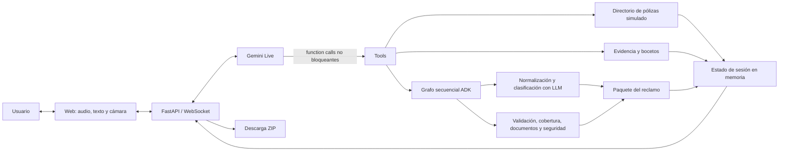

# Revisión de repositorio: `Claim Live Agent Team`

| Campo | Valor |
|---|---|
| **Repo** | https://github.com/AleoshGG/awesome-llm-apps/ |
| **Revisor** | Alexis Guzmán |
| **Fecha** | 13 Octubre 2026 |
| **Commit / versión revisada** | `89e7a62ddc59e9516765700dc5e63eea8d29f7b4` |
| **Decisión que motiva la revisión** | Observar funcionamiento |
| **Tiempo invertido** | 3 horas |

---

## 1. Resumen ejecutivo

**Veredicto:** ⬜ Viable · ☑️ Viable con cambios · ⬜ No recomendado

**En 3-5 líneas:** qué hace, qué tan bien funciona y qué recomiendas.

> Implementa un asistente de admisión de siniestros (FNOL) multimodal en tiempo real que combina conversación por voz, visión por cámara para capturar evidencia y generación de bocetos con Gemini Live, mientras un grafo secuencial de Google ADK valida reglas de póliza en segundo plano. La experiencia interactiva y la baja latencia de respuesta funcionan notablemente bien como prueba de concepto técnica. Se recomienda como arquitectura de referencia para interfaces multimodales con Gemini, pero requiere desacoplar el transporte, persistir el estado de sesión y conectarse a servicios core reales antes de plantear un despliegue productivo.

**Top 3 hallazgos**

1. **Interacción multimodal fluida con herramientas no bloqueantes:** La integración de Gemini 3.8 Live para voz, video e inspección de daños por cámara funciona de forma reactiva y sin congelar la conversación durante la ejecución de tools en segundo plano.
2. **Fuerte acoplamiento y dependencia del ecosistema de Google (Vendor Lock-in):** Toda la solución está ligada estrictamente a `google-genai` y `google-adk`; no existen abstracciones que permitan intercambiar los modelos, el pipeline de voz/STT/TTS o el orquestador sin una reescritura sustancial.
3. **Estado efímero en memoria y ausencia de seguridad empresarial:** La gestión de sesiones reside al 100% en la memoria RAM del proceso (máx. 32 sesiones, TTL de 30 min), sin autenticación de usuarios, sin persistencia en base de datos y con registros de pólizas simulados (*mock*).

**Esfuerzo estimado para llevarlo a producción:** 4 a 6 semanas (equipo de 2 ingenieros: autenticación OAuth2/OIDC, persistencia en BD/Redis, integración con APIs core de pólizas/almacenamiento en la nube, observabilidad OpenTelemetry y contenerización/CI-CD).

---

## 2. Contexto del repo

- **Qué problema dice resolver:** Automatizar la primera notificación de siniestros (*First Notice of Loss* - FNOL) mediante un agente conversacional multimodal que recolecta el relato del asegurado por voz o texto, inspecciona y verifica daños visuales mediante la cámara en vivo, dibuja bocetos de la escena del siniestro y estructura un paquete descargable para el ajustador humano.
- **Tipo de agente:** ⬜ Voz en vivo · ⬜ Chat/texto · ☑️ Multimodal · ☑️ Agente con herramientas · ⬜ Otro: ___
- **Lenguaje / framework principal:** Python 3.12 (Google ADK, Google GenAI SDK, FastAPI, Uvicorn) y JavaScript Vanilla (WebSockets, MediaSource API, Web Audio API).
- **Proveedores externos:** Google AI Studio / Google Cloud Vertex AI (`gemini-3.8-live` para audio/video/avatar, `gemini-3.8-flash` para extracción y verificación de evidencia, `gemini-3.1-flash-image` para bocetos del siniestro).
- **Licencia:** Apache-2.0 (heredada del repositorio upstream `awesome-llm-apps`) → ¿permite uso comercial? ☑️ Sí ⬜ No ⬜ Revisar con legal
- **Salud del repo:** último commit 13 de octubre de 2026 (`89e7a62`) · Fork limpio en desarrollo activo derivado de `awesome-llm-apps` (upstream con >1,200 PRs y alta actividad comunitaria) · 1 mantenedor en este fork (Alexis Guzmán).

---

## 3. Reproducción

**¿Se pudo levantar?** `⬜ Sí, sin cambios`  
**Tiempo para levantarlo desde cero:** 5 min

### Requisitos

| Requisito | Detalle |
|---|---|
| SO / entorno | Linux o MacOS |
| Versión de runtime | Python 3.12 |
| Servicios externos | Google AI Studio |
| Credenciales necesarias | GOOGLE_API_KEY |

### Pasos probados

```bash
# 1. Clonar
git clone https://github.com/AleoshGG/awesome-llm-apps.git
cd awesome-llm-apps

# 2. Configurar entorno
cp .env.example .env   # completar variables

# 3. Instalar dependencias
python3.12 -m venv venv
source venv/bin/activate
pip install -r requirements.txt

# 4. Ejecutar
python -m uvicorn live_demo.server:app --reload --host 127.0.0.1 --port 8080
```

### Problemas encontrados y solución

| # | Problema | Causa | Solución |
|---|---|---|---|
| 1 | <error> | <causa> | <fix> |

### Versiones fijadas

```text
google-adk>=2.0.0a1
google-genai>=2.24.0
fastapi>=0.115
uvicorn[standard]>=0.30
pydantic>=2.7
typing-extensions>=4.12
```

---

## 4. Arquitectura

**Diagrama (texto o Mermaid):**



**Componentes principales**

| Componente | Archivo/carpeta | Responsabilidad |
|---|---|---|
| Interfaz web | `live_demo/index.html`, `live_demo/styles.css`, `live_demo/app.js` | Captura texto, micrófono y fotogramas de cámara; abre la sesión WebSocket, reproduce audio y actualiza transcripción, evidencias y cuaderno. |
| Transporte y loop en vivo | `live_demo/server.py` | Expone FastAPI, administra las sesiones HTTP/WebSocket y retransmite audio, video, texto, transcripciones y respuestas entre el navegador y Gemini Live. |
| Orquestación del reclamo | `agent.py` | Ejecuta un `SequentialAgent` de ADK que normaliza y clasifica el relato, aplica los nodos deterministas y construye el paquete final. |
| Definición de tools | `live_demo/live_tools.py` | Declara `lookup_policy`, `sync_claim_packet`, `pin_evidence_photo` y `draw_incident_sketch` como llamadas no bloqueantes, además de configurar Gemini Live. |
| Ejecución de tools | `live_demo/server.py` | Ejecuta las llamadas en tareas asíncronas, limita a cuatro tools simultáneas y devuelve sus resultados a la sesión de Gemini Live. |
| Manejo de memoria y contexto | `live_demo/server.py`, `agent.py` | Conserva transcripción, póliza, fotos, boceto y último resultado en `IntakeSession`; cada ejecución del grafo usa un `InMemorySessionService` de ADK creado para esa revisión. |
| Prompts | `live_demo/live_tools.py`, `agent.py` | Define las instrucciones de conversación multimodal y las instrucciones de extracción y clasificación del reclamo. |
| Reglas y modelos de dominio | `policies.py`, `schemas.py` | Contiene validación, reglas de cobertura/evidencia, checklist documental, señales de fraude/seguridad y modelos Pydantic. |
| Directorio de pólizas | `policy_directory.py` | Normaliza y consulta registros de pólizas simuladas; no se conecta a una aseguradora real. |
| Pipeline de voz y cámara | `live_demo/app.js`, `live_demo/server.py` | Convierte el micrófono a PCM16 de 16 kHz, envía JPEG de cámara y reproduce audio PCM de 24 kHz; el servidor transmite esos medios a Gemini Live. |
| Avatar opcional | `live_demo/avatar.js`, `live_demo/server.py` | Reproduce el flujo H.264/AAC sincronizado y permite continuar en modo de solo voz si el avatar no está disponible. |
| Evidencia, bocetos y descarga | `live_demo/server.py` | Fija el fotograma actual como evidencia, solicita bocetos al modelo de imagen y genera el ZIP con Markdown, manifiesto y archivos multimedia. |

La aplicación usa dos flujos coordinados: Gemini Live mantiene la conversación en tiempo real, mientras el grafo ADK procesa instantáneas de la transcripción después de los turnos del reclamante o al ejecutar `sync_claim_packet`. Las tools corren en segundo plano para no bloquear la conversación y actualizan el mismo estado de sesión.

El estado se almacena únicamente en memoria del proceso. Reiniciar el servidor o eliminar la sesión descarta la transcripción, las evidencias y el paquete que no se haya descargado.

---

## 5. Mapa de reutilización

| Pieza | ¿Reutilizable? | Acoplamiento | Acción |
|---|---|---|---|
| Captura web de audio, texto y cámara | Con cambios | Medio | Separar captura/reproducción del protocolo WebSocket y de los formatos multimedia esperados por Gemini Live. |
| Transporte y manejo de sesiones | Con cambios | Alto | Extraer una interfaz de sesión en vivo; actualmente `live_demo/server.py` mezcla FastAPI, estado, protocolo de Google, ejecución de tools y reglas del reclamo. |
| Agente conversacional en vivo | Reescribir | Alto | Crear una interfaz independiente del proveedor para conexión, eventos, transcripción, interrupciones, audio/video y llamadas a tools. La implementación actual usa directamente el cliente y los tipos de `google.genai`. |
| Grafo de procesamiento del reclamo | Con cambios | Alto | Conservar la secuencia conceptual, pero desacoplarla de `LlmAgent`, `SequentialAgent`, `Runner` e `InMemorySessionService` de Google ADK. |
| Prompts y definición de tools | Reescribir | Alto | Separar las instrucciones del dominio, los contratos de las tools y el formato específico `FunctionDeclaration` de Gemini. Los nombres y comportamientos están codificados en prompt, servidor e interfaz. |
| Reglas deterministas de admisión | Con cambios | Alto | Extraer `policies.py` detrás de un servicio de dominio. Las funciones son aprovechables para seguros, pero dependen de esquemas y decisiones específicas de reclamos. |
| Esquemas del reclamo | Con cambios | Alto | Mantenerlos únicamente para otro flujo de FNOL similar; para un caso de uso distinto se deben redefinir `ClaimNarrative`, validaciones, clasificación y paquete final. |
| Evidencia, bocetos y paquete ZIP | Con cambios | Medio | Separar almacenamiento, generación de imágenes y empaquetado. La implementación actual depende del estado en memoria y del modelo de imagen de Google. |
| Directorio de pólizas | Reescribir | Alto | Sustituir los registros simulados por un puerto de consulta y un adaptador hacia el sistema real de pólizas. |
| Interfaz visual | Con cambios | Alto | Desacoplar las vistas del esquema del reclamo y de los nombres de tools; el cuaderno, checklist, póliza, evidencias y ruteo están modelados específicamente para seguros. |

**Prueba de intercambio de piezas**

| Cambio probado | Resultado |
|---|---|
| Cambiar de LLM | No se ejecutó una prueba. Las variables de entorno permiten cambiar el identificador por otro modelo compatible de Gemini, pero no cambiar de proveedor. Un proveedor distinto exige reemplazar el cliente de Google, los agentes ADK, sus tipos y el manejo de eventos en `server.py`. |
| Cambiar proveedor de voz | No se ejecutó una prueba. No existe una interfaz de STT/TTS o de sesión en vivo: entrada de audio, transcripción, síntesis, interrupciones y avatar forman parte de la integración con Gemini Live. El cambio requiere una nueva implementación del pipeline y adaptar el protocolo con el navegador. |
| Agregar una tool nueva | No se ejecutó una prueba. Requiere modificar al menos la declaración en `live_tools.py`, el prompt, el despacho de ejecución en `server.py` y, si se muestra actividad específica, `app.js`. No existe un registro extensible o una interfaz común para tools. |

**Acoplamiento al caso de uso:** **Alto.** Los prompts, esquemas, reglas, estado de sesión, tools y componentes visuales representan directamente el flujo de primera notificación de pérdida (FNOL). Reutilizar la solución para otro proceso implica sustituir la mayor parte del dominio y adaptar tanto el backend como la interfaz.

**Dependencia de proveedores (lock-in):** **Alto.** `agent.py` importa Google ADK y fija el modelo de procesamiento; `live_demo/live_tools.py` construye contratos con tipos de Gemini; y `live_demo/server.py` crea clientes de Google y procesa directamente sus eventos de sesión, multimedia y function calling. Las variables de entorno cambian modelos dentro del mismo ecosistema, pero no proporcionan abstracciones para intercambiar el proveedor de IA.

**Conclusión de reutilización:** el repositorio funciona como una demo vertical completa, no como una plataforma desacoplada. Sin el agente y los servicios de Google permanecen partes reutilizables —la captura web, algunas reglas y la estructura de evidencias—, pero no un producto operativo. Antes de adoptarlo como base conviene definir interfaces para el agente conversacional, modelos de extracción y clasificación, generación de imágenes, almacenamiento y ejecución de tools, dejando esta implementación de Google como un adaptador.

---

## 6. Seguridad y costos (checklist rápido)

- [x] Sin secretos hardcodeados en el repo ni en el historial de git *(claves API leídas estrictamente de `.env` y `.env` excluido en `.gitignore`)*
- [x] `.env.example` completo y sin valores reales *(incluye placeholders y comentarios descriptivos)*
- [ ] Validación de entradas a las tools *(declaraciones de esquema en Gemini y parseo defensivo con `.get()`, pero sin validación estricta de esquemas Pydantic en runtime)*
- [x] Permisos mínimos en las herramientas (sin acciones destructivas sin confirmación) *(todas las tools son de lectura simulada o manipulación de estado en memoria local)*
- [ ] Límite de tokens / iteraciones / tiempo por sesión *(posee TTL de 30 min y tope de 20 fotos, pero no existen límites máximos de tokens ni cuotas de gasto en API por sesión)*
- [ ] Protección contra loops infinitos del agente *(el grafo ADK es lineal y acíclico, pero en la sesión en vivo el modelo podría disparar tools repetitivamente sin un circuit breaker formal)*
- [ ] Rate limiting y manejo de errores de API *(captura excepciones básicas y desconexiones, pero carece de rate limiting por IP/token y de reintentos exponenciales ante 429 de Gemini)*
- [ ] Datos sensibles (audio, transcripciones) con política de retención clara *(los datos viven solo en RAM y se purgan tras el TTL, pero no hay cumplimiento formal de GDPR/PII ni DPA)*
- [x] Logs sin información personal *(el logging registra únicamente eventos de ciclo de vida y nombres de errores/tools, sin volcar audios ni transcripciones a texto plano)*

---

## 7. Brechas demo → producción

| Área | Estado en la demo | Qué falta |
|---|---|---|
| Autenticación y autorización | No existe. Solo se genera una cookie no autenticada (`intake_owner`) para ligar el navegador a la sesión en memoria local. | Implementación de Identity Provider (OAuth2 / OIDC / SAML), autenticación con JWT, control de acceso basado en roles (Asegurado, Ajustador, Admin), y autorización granular para ver/descargar expedientes de siniestros. |
| Manejo de errores y reintentos | Básico. Captura excepciones generales (`try/except`), muestra mensajes en la UI y ofrece modo de contingencia a voz si falla el avatar. | Políticas de reintento exponencial con *jitter* ante límites de cuota (HTTP 429) o fallos de red en Gemini; reconexión transparente del WebSocket conservando el contexto exacto; y disyuntores (*circuit breakers*) ante fallos continuos de tools. |
| Observabilidad (logs, trazas, métricas) | Únicamente logs estándar de error en consola mediante el módulo `logging` de Python. | Trazabilidad distribuida con OpenTelemetry para llamadas LLM y WebSockets; métricas de latencia en tiempo real (TTFT, latencia round-trip de voz, tiempos de ejecución de tools); plataforma de observabilidad LLM (Langfuse, Arize Phoenix o Google Cloud Trace); y alertas proactivas. |
| Escalado y concurrencia | Monolítico en memoria local (`sessions = {}`) con límite duro de 32 sesiones concurrentes en un único proceso/hilo. | Externalización del estado de sesión hacia Redis o base de datos relacional (PostgreSQL); desacoplamiento de la gestión de WebSockets y medios mediante WebRTC o gateways dedicados (ej. LiveKit); y workers asíncronos distribuidos para tareas pesadas del grafo ADK. |
| Control de costos | No existe. No se contabilizan tokens en vivo ni se imponen límites de gasto por llamada o por usuario. | Medición y tarificación en tiempo real de tokens (texto, audio, video) y generación de imágenes; cuotas o presupuestos máximos por sesión/usuario; límites de tiempo en llamadas de audio en vivo; y alertas de sobrefacturación. |
| Despliegue (CI/CD, contenedores) | No existe. Se ejecuta manualmente en la máquina del desarrollador mediante `python -m uvicorn`. | Creación de `Dockerfile` multi-etapa optimizado y `docker-compose.yml`; pipeline de CI/CD (GitHub Actions / GitLab CI) con linters, pruebas unitarias automatizadas y análisis de seguridad; y configuración de despliegue en contenedores/cloud (Railway, Cloud Run o Kubernetes). | 

---

## 8. Casos de uso de la empresa

| Caso de uso | ¿Encaja? | Justificación | Cambios necesarios |
|---|---|---|---|
| <caso 1> | ✅ / ⚠️ / ❌ | <...> | <...> |

**Integración mínima prototipada:** ⬜ Sí ⬜ No
- Qué se conectó: <...>
- Resultado: <...>
- Enlace a rama/PR: <...>

---


