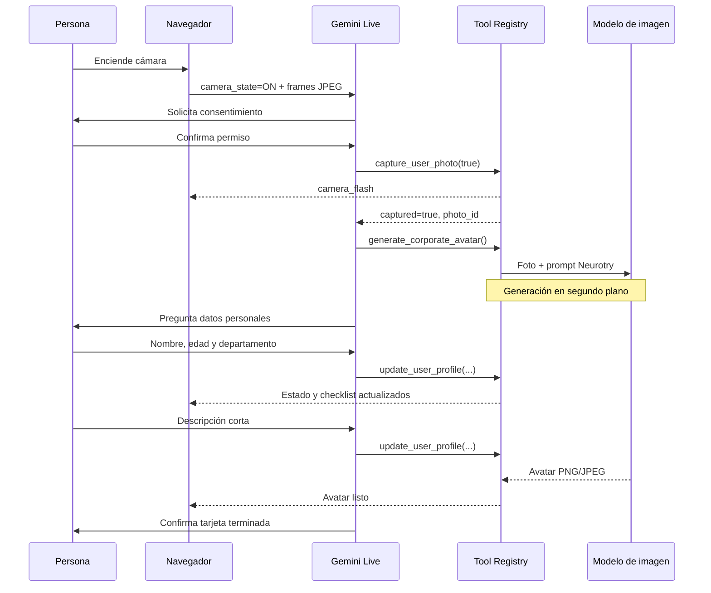

# Resumen técnico de la migración a Neurotry Live Onboarding

## 1. Propósito del cambio

El repositorio comenzó como una demo vertical de admisión de reclamos de seguros. Se reutilizaron sus piezas de transporte multimedia —FastAPI, WebSocket, audio PCM, cámara web y Gemini Live— para convertirlo en una experiencia de onboarding de personal de Neurotry.

El resultado actual permite:

1. Conversar con una asistente de IA por voz o texto.
2. Solicitar consentimiento explícito antes de tomar una foto.
3. Congelar el frame más reciente de la cámara.
4. Generar un avatar corporativo estático a partir de la foto real.
5. Continuar la entrevista mientras el modelo de imagen trabaja en segundo plano.
6. Actualizar una tarjeta de presentación en tiempo real.
7. Abrir la tarjeta en una vista preparada para guardarla como PDF.

La aplicación no genera un avatar de video, un GIF, una vCard ni un ZIP. La conversación usa audio y el avatar de la tarjeta es una imagen estática.

## 2. Decisiones tomadas durante el proceso

| Decisión | Resultado |
| --- | --- |
| Migración | El onboarding reemplazó completamente el caso de seguros. |
| Orden conversacional | Primero consentimiento y foto; después, datos personales. |
| Concurrencia | La generación del avatar comienza después de la foto y no bloquea la entrevista. |
| Estilo del avatar | Corporativo Neurotry azul y neutral, sin depender del departamento. |
| Video del agente | Eliminado. Gemini Live responde únicamente con audio. |
| Entrada escrita | Se conserva como alternativa accesible. |
| Exportación | Vista HTML con `window.print()` para guardar como PDF. |
| Persistencia | Estado en RAM con expiración de 30 minutos. |
| Identidad visual | Tema demo azul, sin logo ni guía de marca oficial. |

El avatar usa vestimenta corporativa neutral porque comienza a generarse antes de conocer el departamento. Regenerarlo al final habría agregado otra llamada, más costo y una segunda latencia.

## 3. Arquitectura final

El código de dominio y aplicación quedó aislado en `onboarding/`. El servidor de FastAPI funciona como composition root: crea implementaciones concretas, conecta dependencias y expone HTTP/WebSocket.

```text
Navegador
  ├── micrófono PCM16 / 16 kHz
  ├── frames JPEG de webcam
  ├── texto alternativo
  └── render de tarjeta
          │
          ▼
live_demo/server.py
  ├── sesiones en memoria
  ├── transporte WebSocket
  ├── ejecución concurrente de tools
  ├── endpoints de assets
  └── composición de servicios
          │
          ├── Gemini Live: conversación, transcripción y function calling
          │
          └── onboarding/
                ├── models.py          modelos y comandos
                ├── policies.py        checklist y completitud
                ├── services.py        casos de uso
                ├── ports.py           interfaces de infraestructura
                ├── tool_registry.py   despacho extensible de tools
                ├── prompts.py         prompts neutrales al proveedor
                ├── live.py            configuración específica de Gemini Live
                ├── gemini_adapter.py  generación multimodal de imagen
                └── card_renderer.py   tarjeta imprimible
```

### Separación de responsabilidades

- `UserProfile` representa datos del dominio; no conoce FastAPI, WebSocket ni Gemini.
- `ProfileService` aplica cambios parciales al perfil.
- `PhotoCaptureService` valida consentimiento, cámara y vigencia del frame.
- `AvatarGenerationService` coordina generación, estados y revisiones.
- `AvatarGenerator` es un puerto; `GeminiAvatarGenerator` es su adaptador de Google.
- `ToolRegistry` relaciona nombres de tools con handlers sin un bloque central de `if/elif`.
- `HtmlBusinessCardRenderer` recibe estado serializado y devuelve HTML seguro.
- `live_demo/server.py` se limita al transporte, sesiones y composición.

## 4. Flujo conversacional por turnos

Los turnos exactos dependen de lo que diga la persona. El prompt fija el orden y las condiciones, pero no obliga a repetir frases literales.

### Turno inicial

Al crear una sesión, el servidor agrega este mensaje visible al historial:

> ¡Hola! Te doy la bienvenida a Neurotry. Primero crearemos tu retrato: enciende la cámara y dime si autorizas que tome una foto para esta tarjeta.

Este turno también se restaura como historial de Gemini si el WebSocket se reconecta.

### Turnos esperados

1. **La IA solicita cámara y consentimiento.**
   - Encender la cámara no implica consentimiento.
   - Un saludo, silencio o respuesta ambigua tampoco implica consentimiento.

2. **La persona confirma explícitamente.**
   - La IA pide mirar a cámara y sonreír.
   - Hace una cuenta regresiva breve.
   - Llama `capture_user_photo` con `consent_confirmed=true`.

3. **El servidor captura la foto.**
   - Congela una copia inmutable del último JPEG.
   - Emite `camera_flash` al navegador.
   - Devuelve el identificador de la foto.

4. **La IA inicia el avatar.**
   - Después de recibir una captura exitosa llama `generate_corporate_avatar`.
   - No espera a que termine para continuar hablando.

5. **La IA entrevista mientras se genera la imagen.**
   - Pregunta nombre completo, edad, departamento y descripción corta.
   - Agrupa las preguntas naturalmente en uno o dos turnos.
   - Después de cada respuesta útil llama `update_user_profile`.

6. **Las ramas convergen.**
   - La tarjeta se considera completa cuando existen los cuatro datos, la foto y el avatar.
   - Si el avatar falla, la foto sirve como preview e imagen imprimible, pero la interfaz diferencia ese fallback de un avatar terminado.



## 5. Tools disponibles

Las tres declaraciones usan `Behavior.NON_BLOCKING`. El servidor puede mantener hasta cuatro tareas de tools en vuelo dentro de una conexión.

### `capture_user_photo`

Responsabilidad: congelar el frame más reciente después del consentimiento.

Entrada:

```json
{
  "consent_confirmed": true
}
```

Validaciones:

- `consent_confirmed` debe ser literalmente `true`.
- La cámara debe estar activa.
- Debe existir un frame JPEG.
- El frame no puede tener más de 12 segundos.

Respuesta exitosa:

```json
{
  "captured": true,
  "photo_id": "<uuid>",
  "message": "Foto guardada con éxito."
}
```

Efectos:

- Copia los bytes del frame para que llegadas posteriores no alteren la foto.
- Incrementa `photo_revision`.
- Asigna `profile.photo_id`.
- Elimina cualquier avatar anterior.
- Emite el evento WebSocket `camera_flash`.

Su respuesta utiliza scheduling `INTERRUPT`, ya que Gemini necesita conocer rápidamente el éxito de la captura para iniciar la generación.

### `generate_corporate_avatar`

Responsabilidad: transformar la foto capturada en un retrato corporativo.

Entrada:

```json
{}
```

Respuesta exitosa:

```json
{
  "generated": true,
  "avatar_id": "<uuid>",
  "message": "Avatar corporativo listo."
}
```

Comportamiento:

1. Cambia `avatar.status` a `generating` y publica estado inmediatamente.
2. Copia los bytes de la foto y su número de revisión.
3. Llama al adaptador multimodal con imagen JPEG y prompt.
4. Extrae la primera parte de imagen válida de la respuesta.
5. Solo guarda el resultado si la sesión sigue activa y la revisión todavía coincide.

Su respuesta usa scheduling `WHEN_IDLE`. El resultado no interrumpe las preguntas que estén en curso.

### `update_user_profile`

Responsabilidad: guardar datos proporcionados o corregidos durante la conversación.

Entrada parcial de ejemplo:

```json
{
  "full_name": "Alex Guzmán",
  "age": 29,
  "department": "Inteligencia Artificial"
}
```

Otra llamada puede completar o corregir la descripción:

```json
{
  "short_description": "Convierto ideas complejas en productos claros"
}
```

Reglas:

- Debe incluir al menos un campo.
- `age` acepta valores entre 1 y 120.
- Nombre, departamento y descripción normalizan espacios.
- Los campos ausentes no borran datos existentes.
- La última corrección explícita reemplaza el valor anterior.

Respuesta:

```json
{
  "saved": true,
  "updated_fields": ["full_name", "age", "department"]
}
```

Utiliza scheduling `WHEN_IDLE` porque la actualización es determinista y no debe interrumpir la conversación.

## 6. Prompts implementados

### Prompt de sistema de la conversación

El prompt completo vive en `onboarding/prompts.py`. Su contenido operativo es:

```text
Eres la anfitriona de onboarding de Neurotry. Habla de forma cálida, breve y natural.
Empieza en español y cambia de idioma solamente si la persona lo pide o continúa
claramente en otro idioma. Eres una asistente de IA y debes decirlo si te preguntan.

El objetivo es crear una tarjeta de presentación corporativa. El orden es obligatorio:
1. Primero pide que encienda la cámara. Explica que la foto vive solo en esta sesión y
   pide consentimiento explícito para capturarla. No interpretes silencio como permiso.
2. Cuando la cámara esté activa y la persona diga claramente que acepta, dile que mire
   a la cámara y sonríe, haz una cuenta regresiva breve y llama capture_user_photo con
   consent_confirmed=true. Nunca llames la herramienta antes del consentimiento.
3. Espera el resultado de captura. Si fue correcto, llama inmediatamente
   generate_corporate_avatar. La generación trabaja en segundo plano: no esperes su
   resultado para continuar hablando.
4. Mientras se genera el avatar, recopila nombre completo, edad, departamento y una
   descripción corta de su rol, superpoder o afición. Agrupa preguntas naturalmente en
   uno o dos turnos. Llama update_user_profile después de cada respuesta útil y también
   cuando la persona corrija un dato. No inventes ni completes datos por tu cuenta.
5. Cuando los cuatro datos, la foto y el avatar estén listos, confirma una sola vez que
   la tarjeta puede visualizarse y guardarse como PDF.

Si la captura falla, explica la causa concreta y permite reintentar. Una nueva foto
reemplaza la anterior. Si la generación falla, continúa la entrevista y ofrece reintentar.
No digas que una tool terminó hasta recibir su resultado. Si la persona dice espera o
detente, reconoce brevemente y espera. Mantén la conversación enfocada en el onboarding.
```

A este prompt se anexan dinámicamente:

- Estado real de la cámara: encendida o apagada.
- Aclaración de que cámara encendida no equivale a consentimiento.
- Fecha y hora local de referencia.

### Prompt del avatar

El prompt visual es deliberadamente neutral respecto al departamento:

```text
Transform this real portrait into a polished professional corporate avatar for
Neurotry. Preserve the person's recognizable facial structure, skin tone, hair,
expression, glasses and visible accessories. Head-and-shoulders composition,
direct friendly gaze, modern blue neurotechnology aesthetic, deep cobalt and
electric cyan accents, clean dimensional lighting, refined editorial illustration,
simple dark-blue background, square crop. Use neutral contemporary business attire.
Do not change apparent age, ethnicity or gender presentation. Do not add text, logos,
watermarks, extra people, extra facial features or distracting objects.
```

El adaptador envía al modelo dos partes multimodales:

1. Los bytes JPEG de la foto real.
2. El texto anterior.

El identificador predeterminado del modelo es `gemini-3.1-flash-image`, configurable mediante `NEUROTRY_IMAGE_MODEL`.

## 7. Ejecución no bloqueante

La no bloqueabilidad se implementa en dos niveles.

### Nivel Gemini Live

Todas las function declarations tienen `Behavior.NON_BLOCKING`. Gemini puede seguir produciendo conversación aunque una tool continúe ejecutándose.

### Nivel servidor

Cada function call se lanza mediante una tarea independiente de `asyncio`. El servidor conserva por separado:

- El loop navegador → Gemini.
- El loop Gemini → navegador.
- Una tarea por tool activa.
- Las tareas de generación de avatar.

Mientras `generate_corporate_avatar` espera al modelo de imagen, `update_user_profile` puede ejecutarse y publicar nuevo estado. Esto es lo que permite observar simultáneamente “Creando avatar Neurotry” y checks de perfil completándose.

### Control de carreras

Cada foto tiene una revisión incremental. La generación conserva la revisión de su foto de origen y la comprueba al terminar.

```text
foto v1 ──► generación lenta v1
   │
   └──── usuario repite foto ──► foto v2

respuesta de generación v1 ──► descartada
```

Así, una respuesta antigua nunca reemplaza el avatar de una captura nueva.

## 8. Modelos y estado

### `UserProfile`

| Campo | Tipo | Regla |
| --- | --- | --- |
| `full_name` | `str | None` | Máximo 120 caracteres. |
| `age` | `int | None` | Entre 1 y 120. |
| `department` | `str | None` | Máximo 80 caracteres. |
| `short_description` | `str | None` | Máximo 240 caracteres. |
| `photo_id` | `str | None` | Se asigna al capturar. |
| `avatar_id` | `str | None` | Se asigna al terminar la imagen. |

### Checklist

El progreso tiene exactamente cinco elementos:

- Nombre.
- Edad.
- Departamento.
- Descripción corta.
- Foto tomada.

El avatar no forma parte del porcentaje. Tiene una máquina de estado independiente:

```text
idle ──► generating ──► ready
                    └─► failed
```

### Estado público enviado a la UI

```json
{
  "session_id": "<id>",
  "revision": 4,
  "profile": {},
  "checklist": [],
  "progress": 60,
  "photo": {},
  "avatar": {
    "status": "generating",
    "asset": null,
    "error": null,
    "url": null
  },
  "profile_complete": false,
  "card_ready": false,
  "print_ready": false,
  "transcript": [],
  "tool_activity": [],
  "camera_enabled": true
}
```

- `card_ready` requiere perfil completo y avatar terminado.
- `print_ready` requiere perfil completo y al menos una imagen utilizable; permite usar la foto como contingencia.
- Los bytes de fotos no se incrustan en el estado JSON. Se descargan desde endpoints protegidos.

## 9. Protocolo WebSocket

### Mensajes navegador → servidor

| Tipo | Contenido | Uso |
| --- | --- | --- |
| `text` | `text`, `id` | Turno escrito alternativo. |
| `audio` | PCM16 base64 a 16 kHz | Voz del usuario. |
| `video` | JPEG base64 | Frame de cámara y visión para Gemini. |
| `camera_state` | `enabled` | Informa el estado real de la cámara. |
| `close` | — | Cierre intencional. |

La UI envía frames cada 850 ms, con ancho de 640 píxeles y calidad JPEG de 0.72.

### Mensajes servidor → navegador

| Tipo | Uso |
| --- | --- |
| `ready` | La sesión Gemini Live está lista. |
| `session` | Modelos y tools activos. |
| `state` | Estado completo de onboarding. |
| `transcript` | Segmento provisional o turno final. |
| `tool` | Inicio, fin, error y duración de una tool. |
| `camera_flash` | Activa el destello visual al congelar el frame. |
| `audio` | PCM base64 producido por Gemini. |
| `interrupted` | Detiene audio que fue cancelado por el usuario. |
| `turn_complete` | Fin lógico de una respuesta del agente. |
| `error` | Error recuperable para mostrar en la conversación. |

## 10. Endpoints HTTP

| Método y ruta | Propósito |
| --- | --- |
| `GET /api/health` | Estado, modelos y tools configurados. |
| `POST /api/sessions` | Crea una sesión y el saludo inicial. |
| `GET /api/sessions/{id}` | Recupera una sesión existente. |
| `DELETE /api/sessions/{id}` | Cancela tareas y elimina medios de RAM. |
| `GET /api/sessions/{id}/assets/photo` | Sirve el JPEG capturado. |
| `GET /api/sessions/{id}/assets/avatar` | Sirve la imagen generada. |
| `GET /api/sessions/{id}/business-card` | Devuelve la tarjeta HTML imprimible. |
| `WS /ws/live?session_id={id}` | Conecta navegador y Gemini Live. |

Una cookie HTTP-only llamada `onboarding_owner` liga las rutas a su navegador. La demo acepta conexiones locales, limita el total a 32 sesiones y permite hasta cuatro sesiones por propietario.

## 11. Tarjeta e interfaz

La interfaz se reemplazó por un diseño azul neurotech de tres zonas:

1. Cámara, consentimiento implícito en la conversación y actividad de procesos.
2. Vista previa central de la tarjeta.
3. Transcripción y checklist del perfil.

La imagen sigue esta progresión:

```text
silueta inicial → foto real capturada → avatar corporativo
```

Durante la generación, la foto sigue visible con un indicador animado. Al mismo tiempo, nombre, edad, departamento y descripción aparecen en la tarjeta a medida que las tools los guardan.

El botón “Guardar como PDF” abre `/business-card`. Esa vista:

- Escapa los textos personales antes de insertarlos en HTML.
- Usa el avatar si existe y la foto como fallback.
- Define tamaño de impresión A6 horizontal.
- Llama `window.print()` después de cargar.

No existe un generador binario de PDF en el backend; el navegador realiza la conversión.

## 12. Error de desconexión encontrado y corrección

Durante la prueba conversacional, el WebSocket se desconectaba después de una respuesta normal de la IA.

### Causa

En el SDK instalado, `live_session.receive()` produce los mensajes de **un solo turno completo** y termina su iterador cuando encuentra `turn_complete`. El servidor recorría ese iterador una sola vez:

```python
async for response in live_session.receive():
    ...
```

Al terminar la respuesta, la tarea receptora finalizaba. El coordinador utilizaba `asyncio.FIRST_COMPLETED`, interpretaba esa finalización como cierre de la conexión y cancelaba el resto de las tareas.

### Solución

Se agregó `receive_live_messages`, que abre ciclos sucesivos de recepción:

```python
async def receive_live_messages(live_session):
    while True:
        received = False
        async for message in live_session.receive():
            received = True
            yield message
        if not received:
            return
```

Ahora un `turn_complete` finaliza únicamente el turno actual; no finaliza la sesión WebSocket.

## 13. Manejo de fallos

| Situación | Comportamiento |
| --- | --- |
| Sin consentimiento | La captura devuelve un mensaje solicitando autorización explícita. |
| Cámara apagada | Se pide encender la cámara. |
| Frame inexistente u obsoleto | Se solicita mirar a cámara e intentar de nuevo. |
| Generación sin foto | Se rechaza la tool. |
| Modelo sin imagen | El avatar pasa a `failed`; la entrevista continúa. |
| Nueva foto durante una generación | La respuesta antigua se descarta por revisión. |
| Tool desconocida | Se devuelve un error controlado. |
| Más de cuatro tools simultáneas | Se pide esperar a que termine una tarea. |
| Interrupción del usuario | Gemini cancela la salida y la UI detiene la reproducción. |
| Desconexión | Se conservan perfil y assets; se limpian cámara y tareas en vuelo. |
| Expiración | Se cancelan tareas y se liberan bytes de foto, avatar y frame. |

## 14. Pruebas agregadas

La suite actual contiene 12 pruebas Python y verificaciones JavaScript.

Cobertura principal:

- Checklist determinista de cinco elementos.
- Normalización de textos y validación de edad.
- Consentimiento, cámara y vigencia del frame.
- Inmutabilidad de la foto congelada.
- Invalidación del avatar después de una retoma.
- Actualización del perfil mientras la generación está pausada.
- Protección frente a generaciones fuera de orden.
- Emisión del flash de cámara.
- Configuración de Gemini en modo solo audio.
- Declaración de las tres tools nuevas.
- Recepción de múltiples turnos sin desconectar la sesión.
- Contrato del estado público, assets y tarjeta imprimible.
- Expiración de sesiones.
- Presencia de estados no bloqueantes y escape HTML en el cliente.

Comandos:

```bash
python -m unittest discover -s tests -p 'test_*.py'
node tests/client-regressions.cjs
```

La prueba clave de concurrencia es `test_profile_updates_while_avatar_generation_is_running`: el generador espera un evento artificial, el perfil se actualiza durante esa espera y después se libera la generación.

## 15. Archivos modificados

### Nuevos

- `onboarding/__init__.py`
- `onboarding/models.py`
- `onboarding/policies.py`
- `onboarding/ports.py`
- `onboarding/services.py`
- `onboarding/prompts.py`
- `onboarding/live.py`
- `onboarding/tool_registry.py`
- `onboarding/gemini_adapter.py`
- `onboarding/card_renderer.py`
- `tests/test_onboarding.py`
- `tests/test_server.py`
- `resume.md`

### Reemplazados o actualizados

- `live_demo/server.py`
- `live_demo/app.js`
- `live_demo/index.html`
- `live_demo/styles.css`
- `README.md`
- `.env.example`
- `requirements.txt`
- `__init__.py`
- `tests/client-regressions.cjs`

### Retirados del caso de seguros

- `agent.py`
- `schemas.py`
- `policies.py`
- `policy_directory.py`
- `examples.py`
- `live_demo/live_tools.py`
- `live_demo/avatar.js`
- `live_demo/metrics.py`
- Pruebas específicas de reclamos, bocetos y avatar de video.

También se eliminó `google-adk` de las dependencias porque el nuevo flujo no usa un grafo ADK.

## 16. Configuración

Variables disponibles:

```dotenv
GOOGLE_API_KEY=replace-me

# NEUROTRY_LIVE_MODEL=gemini-3.8-live
# NEUROTRY_IMAGE_MODEL=gemini-3.1-flash-image
# NEUROTRY_VOICE=Kore
# NEUROTRY_TRANSCRIPTION_VOCABULARY=Neurotry,Nombre interno
# NEUROTRY_CORS_ORIGINS=http://127.0.0.1:4177,http://localhost:4177
```

Arranque:

```bash
python -m uvicorn live_demo.server:app --reload --host 127.0.0.1 --port 4177
```

## 17. Limitaciones actuales

- No existe persistencia: reiniciar el proceso elimina todas las sesiones.
- No existe autenticación empresarial; la cookie solo aísla sesiones locales.
- No hay reintentos exponenciales ni circuit breaker para Gemini.
- No hay cuota de costo o tokens por sesión.
- El PDF depende del diálogo de impresión del navegador.
- La experiencia real de cámara, micrófono y modelo debe validarse manualmente en un navegador compatible.
- El color azul y el wordmark son provisionales; no representan una guía de marca oficial.
- La calidad de conservación facial depende del modelo de imagen configurado.

## 18. Recorrido manual recomendado

1. Iniciar el servidor y abrir `http://127.0.0.1:4177`.
2. Encender la cámara.
3. Pulsar “Hablar”.
4. Saludar sin dar consentimiento y comprobar que no se toma la foto.
5. Autorizar explícitamente la captura.
6. Verificar destello y preview de la foto.
7. Confirmar que aparece “Creando avatar Neurotry”.
8. Mientras sigue activo, proporcionar nombre, edad y departamento.
9. Confirmar que esos datos aparecen antes de que termine el avatar.
10. Dar la descripción corta.
11. Esperar el reemplazo de la foto por el avatar.
12. Corregir un dato y comprobar la actualización.
13. Repetir la foto y verificar que el avatar anterior desaparece.
14. Abrir “Guardar como PDF” y comprobar el formato A6 horizontal.
15. Mantener al menos tres turnos de conversación para verificar que el WebSocket ya no se desconecta al terminar cada respuesta.
